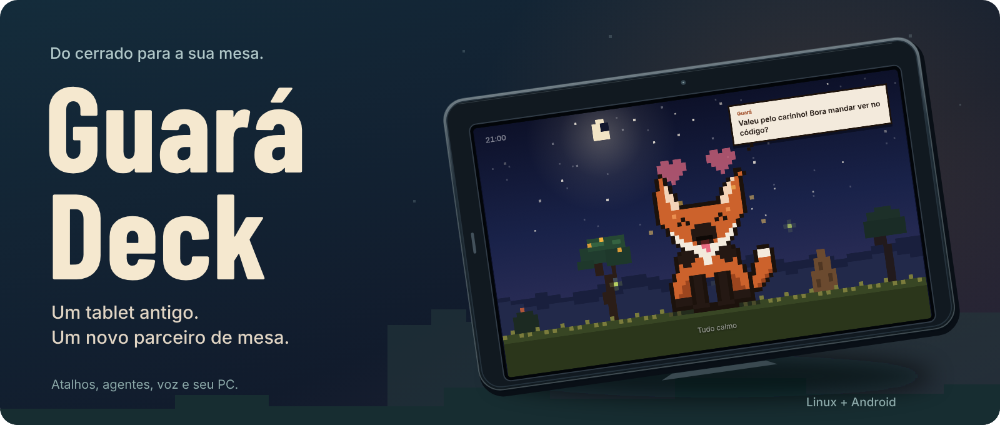
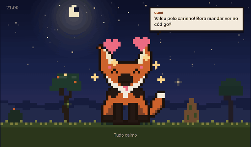
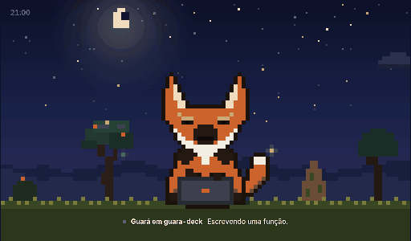
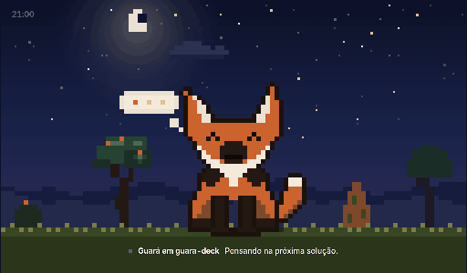
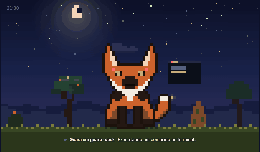
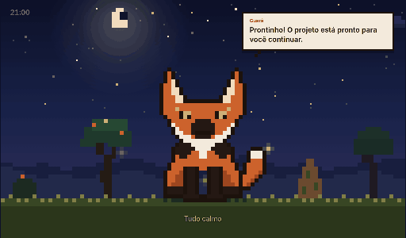
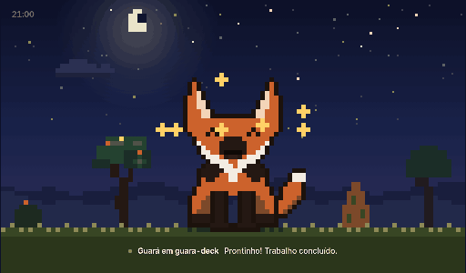
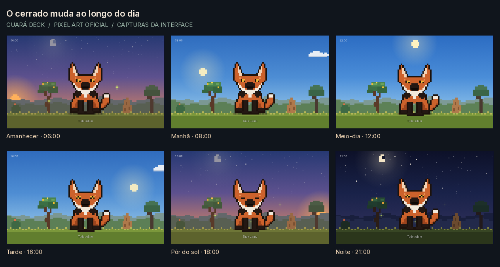
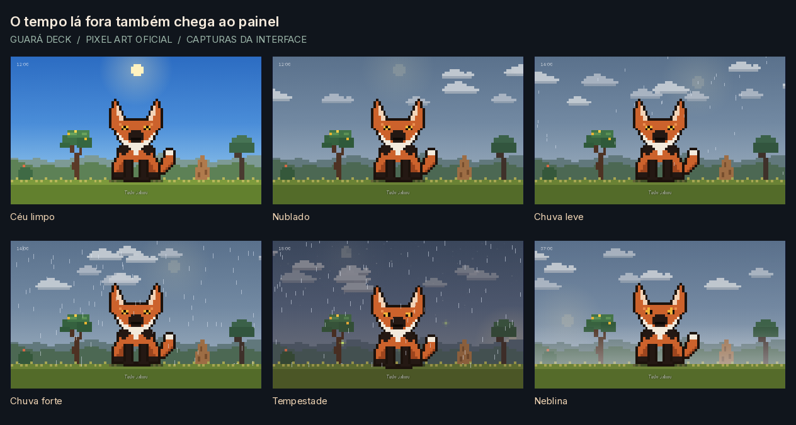

<p align="center">
  
</p>
<p align="center">
  
  
  
</p>
<p align="center">
  <a href="https://github.com/icbmmateus16/guara-deck/archive/refs/heads/main.zip">Baixar código (ZIP)</a> · <a href="#começar">Começar</a> · <a href="docs/instalacao.md">Instalação completa</a> · <a href="docs/configuracao.md">Configuração</a> · <a href="docs/galeria.md">Galeria</a> · <a href="CONTRIBUTING.md">Contribuir</a>
</p>

O Guará Deck transforma um tablet Android antigo em um painel de apoio para programar: atalhos, música, informações do PC e atividade dos agentes num lugar só. Ao lado fica o Guará, um lobo-guará animado que acompanha o que está acontecendo.

Fiz para usar um **Genesis GT-7305 de 7 polegadas**, com Android 4.4 e tela de 1024 × 600. O PC faz o trabalho pesado; o tablet fica com a interface e os toques. A ideia é dar uso ao que já estava parado na gaveta.

> **Estado do projeto:** uso pessoal, agora aberto para quem quiser experimentar. O foco atual é Linux com GNOME e o tablet acima. Outros aparelhos e ambientes ainda precisam de testes. Não há firmware para ESP32 neste repositório.

## Por que um lobo-guará?

Quis dar ao projeto uma identidade brasileira. O lobo-guará (*Chrysocyon brachyurus*) faz parte da nossa fauna e é um dos símbolos do Cerrado. As orelhas grandes, as pernas compridas e a pelagem avermelhada dão ao personagem uma presença própria — e fazem o cenário do cerrado ter sentido junto dele.

O [ICMBio](https://www.gov.br/icmbio/pt-br/centrais-de-conteudo/publicacoes/publicacoes-diversas/fauna-e-flora/Fogo_e_Fauna_da_Canastra_Guia_de_Mamiferos_compressed.pdf) descreve a espécie como o maior canídeo sul-americano e destaca sua ligação com o Cerrado. Ele ocorre no Brasil e em outros países da América do Sul; a distribuição por áreas abertas é detalhada pelo [Instituto Pró-Carnívoros](https://procarnivoros.org.br/animais/lobo-guara/).

Essa foi a escolha para o companheiro da mesa: trazer um pouco da fauna brasileira para um projeto feito aqui, com o cerrado participando da experiência ao longo do dia.

## Um companheiro de mesa

O Guará oficial é o **pixel art que aparece abaixo**. Ele muda de expressão, usa objetos e reage aos toques conforme o que acontece no painel.

| Um carinho entre as tarefas | Digitando | Pensando |
| :---: | :---: | :---: |
|  |  |  |

| No terminal | Uma mensagem para você | Trabalho concluído |
| :---: | :---: | :---: |
|  |  |  |

[**Ver a galeria completa →**](docs/galeria.md) Carinho, leitura, busca, aprovação, erro, sono, escuta, fala, subagentes e interação com o céu.





<sub>Capturas da interface com dados demonstrativos. Horários e climas foram definidos para mostrar as variações; os GIFs não têm áudio.</sub>

| Na mesa | O que dá para fazer |
| :--- | :--- |
| **Painel do PC** | Ver CPU, memória, GPU e bateria; controlar volume, mídia e ajustes do GNOME. |
| **Atalhos e projetos** | Abrir aplicativos, pastas, editor e terminal; consultar Git e containers Docker. |
| **Agentes** | Acompanhar sessões do Claude Code e do Codex; responder pedidos de aprovação do Claude. |
| **Voz** | Conversar pelo microfone, ouvir respostas e receber avisos de tarefas. Requer componentes extras. |
| **WhatsApp** | Consultar mensagens, ouvir áudios, resumir grupos e confirmar respostas no tablet. Requer vinculação ao WhatsApp Web. |
| **Modo jogo** | Pausar a captura de voz durante jogos e liberar o modelo de transcrição da GPU. |
| **Música** | Buscar no YouTube e reproduzir no PC ou pelo áudio nativo do app. Requer ferramentas extras. |
| **Modo Guará** | Deixar o mascote em tela cheia, com céu, chuva e luz do dia baseados no clima. |
| **Tablet Genesis** | Efeitos na logo iluminada e botão de hotspot ACESSO no GNOME 50. Recursos opcionais específicos da instalação. |

A interface usa JavaScript ES5 por causa do WebView antigo. O app Android é uma casca em tela cheia com microfone, áudio PCM e descoberta do servidor pela rede.

## Começar

Você precisa de um PC Linux, Python **3.10+** e um navegador para experimentar o painel. As integrações com o desktop foram feitas para GNOME, PipeWire e uma sessão gráfica ativa.

```bash
git clone https://github.com/icbmmateus16/guara-deck.git
cd guara-deck
python3 -m venv --system-site-packages .venv
.venv/bin/python -m pip install -r requirements.txt
cp server/config.example.json server/config.json
.venv/bin/python server/capi_server.py
```

Abra no navegador a URL que aparece no terminal. O servidor cria um **token exclusivo da sua instalação**; essa URL dá acesso ao painel e deve ficar com você.

No Ubuntu, instale `python3-venv`, `python3-gi` e `gir1.2-gtk-3.0` se estiverem faltando. Para usar o tablet, compile o app com seu próprio token seguindo o [guia de instalação](docs/instalacao.md). Voz, YouTube, inicialização automática e hooks estão no mesmo guia.

**Use somente numa rede local de confiança.** O painel controla o computador e usa HTTP. Não encaminhe a porta para a internet. O APK gerado contém o token do servidor: não compartilhe esse arquivo.

## Por dentro

```text
server/                  HTTP, eventos SSE, ações do PC, agentes e voz
  config.example.json    exemplo público, sem credenciais
web/                     interface e animações do Guará
tablet/
  app/                   código Java, manifesto e recursos Android
  setup/                 ajustes específicos do tablet original (opcionais)
  build.sh               compilação local com Android SDK
docs/                    instalação, configuração e imagens
scripts/                 verificação dos arquivos versionados
.github/                 verificações e modelos para contribuições
```

O PC serve o painel por HTTP/SSE na porta `47801` e anuncia sua presença por UDP na `47800`. O tablet procura esse anúncio e envia as ações ao servidor. As integrações de IA dependem das CLIs instaladas e autenticadas no seu PC.

## Ajustar para a sua mesa

Edite `server/config.json` para trocar atalhos, nome do assistente, motores de voz e coordenadas do clima. Esse arquivo é local e fica fora do Git. As opções e limitações estão em [configuração](docs/configuracao.md).

Algumas partes ainda refletem a primeira instalação: a pasta de projetos é `~/Área de trabalho/PROJETOS`, o build espera Android SDK 34 e os controles de brilho via ADB são específicos do Genesis. Prefiro deixar isso explícito a prometer que funciona em qualquer máquina.

## Projetos na mesma ideia

Vale conhecer o [FreeTouchDeck](https://github.com/DustinWatts/FreeTouchDeck), que usa ESP32, tela touch e Bluetooth; o [Stream32](https://github.com/FadyFaheem/Stream32), também baseado em ESP32; e o [Stream-Pi](https://github.com/stream-pi/server), um macropad modular. São boas referências para quem gosta de montar o próprio painel.

Aqui o caminho foi reaproveitar um Android e deixar o processamento no PC, com um companheiro do cerrado na tela.

## Contribuir

Testou em outro tablet? Encontrou um problema? Abra uma [issue](https://github.com/icbmmateus16/guara-deck/issues) com o modelo, versão do Android e ambiente do PC. O [guia de contribuição](CONTRIBUTING.md) explica como rodar as verificações e enviar alterações sem expor dados da sua máquina.

Código do projeto sob [licença MIT](LICENSE). Fontes de terceiros mantêm suas próprias licenças, listadas em [THIRD_PARTY_NOTICES.md](THIRD_PARTY_NOTICES.md).
